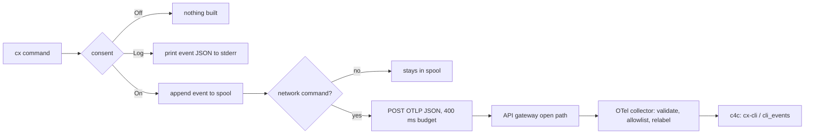
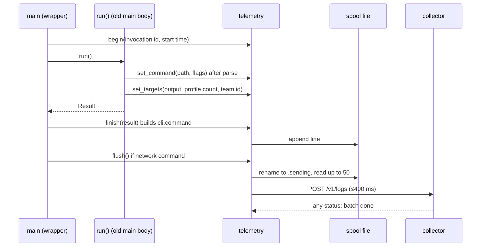

# Plan: cx CLI client-side telemetry (M1–M4)

| Field | Value |
|-------|-------|
| Status | in-progress |
| Created | 2026-11-15 |
| Ticket | [HEA-36](https://linear.app/coralogix/issue/HEA-36/add-client-telemetry-to-the-cli) |
| Branch | claude/telemetry-design-milestones-397571 |

## Context

Product cannot see how `cx` is used. The gateway metric counts only management
endpoints, so query commands, local commands and the whole onboarding funnel are
invisible. We add client-side usage events, sent as OTLP logs to a dedicated OTel
collector that forwards them to c4c (application `cx-cli`, subsystem `cli_events`).

Constraints:
- The audit-logs path is ruled out.
- No secret ships in the binary.
- Telemetry must never slow a command by more than 400 ms or break it.
- Argument values, query text and credentials are never read.

The field-by-field schema and the collector config are in
[contributing/telemetry-design-draft.md](../contributing/telemetry-design-draft.md).
That file is the spec for this plan.

**Scope of this plan:** milestones 1–4, all in this repo. The public docs (M5) and the
staging collector (M6) are listed at the end as follow-ups. No release build has an
endpoint until M6, so after this plan ships, telemetry stays a silent no-op for users.

## Architecture Decisions

- **Transport:** a dedicated OTel collector behind the API gateway, on the open path
  `/api/v2/cli-telemetry`, which is rewritten to the collector's `/v1/logs`. The c4c
  key lives only in the collector.
- **Validation lives in the collector.** The client reads the spool strictly: unknown
  enum values fail to parse and the line is dropped. Unknown fields are ignored, and
  because events are re-encoded from typed structs, ignored fields are never sent.
- **No OTel SDK.** The OTLP JSON body is built with `serde_json` and sent with
  `reqwest`, both already dependencies.
- **The endpoint is set at build time** via `option_env!("CX_TELEMETRY_ENDPOINT")`.
  Source and dev builds have none, so telemetry is off. A runtime
  `CX_TELEMETRY_ENDPOINT` overrides it (tests, staging, local collector).
- **Spool, then flush.** Each event is one line in `~/.cx/telemetry-spool.jsonl`. Only
  commands that already use the network flush, with a 400 ms total budget.
  - Any HTTP response ends the batch.
  - A network failure puts the batch back, where it can stay for up to 7 days.
- **Opt-out stops events being built, not just sent:** `CX_TELEMETRY=0`,
  `DO_NOT_TRACK=1`, or `telemetry = false` in `~/.cx/config.toml`.
  - `CX_TELEMETRY=log` prints each event to stderr and sends nothing, on any build.
  - A one-time notice is printed before the first event is recorded.
- **`team_id` is client-claimed.** It is read from the profile's existing
  `cached_team_id`. No request is made to fetch it.
- **One process-wide invocation record.** `main` has many early returns. The command
  path and flags are stored right after parsing, and the existing `main` body becomes
  `run()`, wrapped by a thin `main` that emits `cli.command`.
- **Changes found while planning** (not in the original draft):
  - `WINDSURF_AGENT` was added to `safety::AGENT_ENV_VARS`. The collector regex in the
    draft now includes `windsurf_agent`.
  - `update_check::fetch_if_stale` saves a stale copy of `state.json` after a 10 s
    fetch. That would overwrite the new telemetry state fields. It must reload the
    file before saving (fixed in 1.3).
  - `cx.version.latest` comes from the GitHub API, which is external input. It is
    parsed as strict `MAJOR.MINOR.PATCH` before recording, never copied through.
  - `cli.first_run` fires when `version_cache::installation_id()` creates the
    install ID. That function has no other callers today.
  - There is no Ctrl-C handler. `cancelled` is used when an inquire prompt is
    cancelled or interrupted.

## Diagrams

## Milestones Overview

1. **Inspectable events, nothing sent:** the module builds and spools events, with consent, notice and inspect mode.
2. **Every command run produces an event:** wiring in `main`, including parse errors and first run.
3. **Events leave the machine:** OTLP encoding, the bounded flush, and a check against a real collector.
4. **Funnel and lifecycle events:** onboarding, skills, risky-command prompts, updates.

---

## Milestone 1: Inspectable events, nothing sent

**Why this matters:** Security and product reviewers, and any curious user, can run
`CX_TELEMETRY=log cx logs ...` and see exactly what would be sent. That makes the
data contract checkable before a single byte leaves a machine.

**Success criteria:** With `CX_TELEMETRY=log`, an event prints as JSON on stderr.
With any opt-out set, no event is built and no spool file is created.

**Key decisions:**
- The module is `src/telemetry/`, with four files: `event`, `consent`, `spool`, `send`.
- Each event field is a Rust enum, a UUID, a number, a bool, or a newtype that can only
  be built from clap names, fixed lists, or a strictly parsed version. Free text
  cannot be represented.
- Spool lines use the OTLP attribute keys (`cx.command.path`, ...). The JSON that
  inspect mode prints therefore matches what is sent.

### Deliverable Spec

| Key | Type | Default | Description |
|---|---|---|---|
| `CX_TELEMETRY` | env | unset | `0`/`false`/`off`/`no` disables; `log` prints events and sends nothing |
| `DO_NOT_TRACK` | env | unset | `1`/`true` disables |
| `telemetry` | bool in `~/.cx/config.toml` | `true` | `false` disables |
| `CX_TELEMETRY_ENDPOINT` | build-time and runtime env | unset | collector URL; unset means off |
| `~/.cx/telemetry-spool.jsonl` | file | — | one JSON event per line, max 500 lines, 7 days |
| `telemetry_notice_shown` | bool in `~/.cx/state.json` | absent | set once the notice has been printed |

### 1.1 [x] Event model *(completed 2026-11-15)*
- **Files:** `src/telemetry/mod.rs`, `src/telemetry/event.rs`, `src/lib.rs`
- **What:** Define the event types and attribute enums from the spec's "Event schema"
  section: eight event names, the command set, and the resource attributes.
  - All enums serialize to the lowercase strings in the spec.
  - Resource attributes come from `CARGO_PKG_VERSION`, `std::env::consts` (mapped to
    `darwin`/`linux`/`windows` and `arm64`/`amd64`), `version_cache::installation_id()`
    and `install_method::detect()`.
  - The agent is the lowercased name of the first set var in `safety::AGENT_ENV_VARS`,
    else `direct`.
  - The event serializes flat, with `time_unix_nano` plus attribute keys, and
    deserializes back.
- **Acceptance:** Unit tests:
  - Each enum serializes to the spec's strings.
  - An event round-trips through JSON.
  - An unknown enum value fails to deserialize.
  - An unknown field is ignored and never re-serialized.
- **Dependencies:** None

### 1.2 [x] Command sanitization from ArgMatches *(completed 2026-11-15)*
- **Files:** `src/telemetry/event.rs`
- **What:** Build `cx.command.path` and `cx.command.flags` by walking
  `clap::ArgMatches` alongside the `clap::Command` tree.
  - The path is subcommand names joined by spaces, max 4.
  - The flags are sorted, de-duplicated `--long` names joined by commas, max 30.
  - Include only args whose value source is the command line and that have a long
    name. Never call an accessor that reads an argument's value.
  - Works for both trees, `Cli` and `ProfilesCli`.
- **Acceptance:** Unit tests:
  - A sentinel secret is planted as a positional argument and as a flag value. The
    serialized event does not contain it.
  - A nested command gives `alerts list`.
  - Flags given in a different order give the same string.
  - Flags set from env vars are not included.
- **Dependencies:** 1.1

### 1.3 [x] Consent and first-run notice *(completed 2026-11-15)*
- **Files:** `src/telemetry/consent.rs`, `src/config.rs`, `src/version_cache.rs`, `src/update_check.rs`
- **What:** One function returning `Off`, `Log` or `On`, from the env vars and the
  new `telemetry` config key. `On` also requires an endpoint.
  - Add `telemetry_notice_shown` to the state file as an optional field, so old files
    still load.
  - Before the first event in `On` mode, print the notice text from the design page
    once, on stderr. If the notice cannot be marked as shown, record nothing.
  - Fix `fetch_if_stale` so it reloads `state.json` before saving and only overwrites
    the fields it fetched.
- **Acceptance:** Unit tests:
  - Every opt-out works.
  - `log` works.
  - No endpoint means `Off`.
  - Existing state files without the new fields still deserialize.
- **Dependencies:** 1.1

### 1.4 [x] Spool and inspect mode *(completed 2026-11-15)*
- **Files:** `src/telemetry/spool.rs`, `src/telemetry/mod.rs`
- **What:** `record(event)`:
  - In `Log` mode, print `cx telemetry: <event JSON>` to stderr.
  - In `On` mode, append one line to the spool with a single write.
  - In `Off` mode, do nothing.

  Reading drops lines that fail to parse, lines older than 7 days, and everything
  beyond the 500 newest lines. To send, rename the spool to a `.sending` file first,
  so a concurrent `cx` cannot lose events. The next flush picks up a `.sending` file
  older than a minute. All I/O errors are swallowed.
- **Acceptance:** Unit tests with a temp dir:
  - Append, then read back.
  - Corrupt and expired lines are dropped.
  - The cap holds.
  - `Off` creates no file.
- **Dependencies:** 1.1, 1.3

---

## Milestone 2: Every command run produces an event

**Why this matters:** This answers the core product question: which commands people
run, with what outcome and duration, and whether a human or an agent drives them.
After this milestone every invocation yields one event, including local commands the
gateway never sees.

**Success criteria:** `CX_TELEMETRY=log cx alerts list --limit 5` prints one
`cli.command` event with path `alerts list`, flags `--limit`, an outcome and a
duration. A mistyped command prints one `cli.parse_error` event.

**Key decisions:**
- The existing `main` body moves to `run()`. `main` becomes a small wrapper that
  times it and emits the event.
- The two `std::process::exit(1)` calls after target resolution return a private
  `SilentExit` error instead. The wrapper records the event, then exits with code 1
  and prints nothing more, so the output is unchanged.

### Before/After

Currently `main` returns from nine places and exits from two more, and nothing records
what ran. After this milestone every path ends in one place, which records a
`cli.command` event.

### 2.1 [x] Invocation record and main wrapper *(completed 2026-11-15)*
- **Files:** `src/main.rs`, `src/telemetry/mod.rs`
- **What:** Add a process-wide invocation record: invocation UUID, start time,
  command path, flags, output format, profile count, spilled, team id, and a
  network flag.
  - Set the command fields right after each of the two parse sites (the `profiles`
    fast path and the main parser).
  - Rename the current `main` body to `run()` and wrap it. On return, build
    `cli.command` with the outcome, the error class (first `CxError` in the anyhow
    chain, else `usage`) and the duration, then record it.
  - Behaviour and exit codes of every command must be unchanged.
- **Acceptance:**
  - An integration test (`tests/telemetry/main.rs`, pattern from `tests/first_run`)
    runs the real binary with `CX_TELEMETRY=log` for a local command. It asserts one
    `cli.command` event on stderr with the right path.
  - The no-profile guidance test still passes byte for byte.
  - The full existing suite passes.
- **Dependencies:** 1.2, 1.4

### 2.2 [x] Outcome details *(completed 2026-11-15)*
- **Files:** `src/main.rs`, `src/telemetry/mod.rs`, `src/spill.rs`
- **What:** Fill in the remaining `cli.command` attributes:
  - `cx.http.status_class` from the `CxError::Api` status (`2xx` on success for
    network commands, else `none`).
  - `cx.output.format`, `cx.profile.count` and `cx.team.id` once targets are resolved.
  - `cx.spilled` when output is written to a file.
  - Outcome `cancelled` when an inquire prompt is cancelled or interrupted.
- **Acceptance:** Wiremock integration test:
  - A 401 response gives error class `auth`.
  - A 500 gives `api` and `5xx`.
  - A 200 gives `success` and `2xx`.
- **Dependencies:** 2.1

### 2.3 [x] Parse errors and first run *(completed 2026-11-15)*
- **Files:** `src/main.rs`, `src/telemetry/mod.rs`, `src/version_cache.rs`
- **What:** Switch both parse sites to `try_get_matches`.
  - On error, record `cli.parse_error` with `cx.parse.kind` mapped from clap's error
    kind, then let clap print and exit exactly as before. Help and version are not
    errors.
  - Record `cli.first_run` when the installation ID is created in this process.
- **Acceptance:** Integration tests:
  - An unknown subcommand gives `cli.parse_error` with `unknown_command`, with the
    same exit code and message as today.
  - `--help` gives no parse error.
  - A fresh home dir gives one `cli.first_run`, and a second run gives none.
- **Dependencies:** 2.1

---

## Milestone 3: Events leave the machine

**Why this matters:** Product has no dashboards until events reach c4c. This milestone
delivers them without ever making a command slower or noisier, and it proves the
payload passes the collector's real validation rules.

**Success criteria:**
- Against a mock server, an API command posts one valid OTLP request and empties the
  spool.
- With the server down, the command's output and exit code are unchanged, it stays
  within the 400 ms budget, and the events stay spooled.
- A local `otelcol-contrib` running the spec's config accepts the CLI's real events.

**Key decisions:** Local commands never flush. The flush runs after the command result
is known and is bounded at 400 ms in total.

### Deliverable Spec

| Endpoint | Method | Body | Response handling |
|---|---|---|---|
| `$CX_TELEMETRY_ENDPOINT` | POST | OTLP/HTTP JSON `resourceLogs`, max 50 records, `Content-Type: application/json` | any status: batch removed; network error or timeout: batch kept |

### 3.1 [x] OTLP JSON encoding *(completed 2026-11-15)*
- **Files:** `src/telemetry/send.rs`
- **What:** Turn a batch of events into the OTLP logs JSON body shown in the spec's
  example:
  - resource attributes once
  - one log record per event
  - `timeUnixNano` as a string
  - ints as `intValue` strings, bools as `boolValue`
  - no body
- **Acceptance:** A unit test compares the encoded body for a fixed event against the
  spec's example request.
- **Dependencies:** 1.1

### 3.2 [x] Bounded flush *(completed 2026-11-15)*
- **Files:** `src/telemetry/send.rs`, `src/telemetry/mod.rs`, `src/main.rs`
- **What:** `flush()` takes up to 50 spooled events and POSTs them with a plain
  `reqwest` client.
  - No auth header, user agent `cx-cli/<version>`, total timeout 400 ms.
  - The rest go back to the spool.
  - Call it from the `main` wrapper only for commands that built execution targets,
    and after `cx init` / `cx profiles add`.
  - Do not import from `api_client`.
- **Acceptance:** Wiremock integration test in `tests/telemetry/main.rs`:
  - The request body is valid OTLP and the spool is empty afterwards.
  - With the mock delayed past the budget, the command still exits on time and the
    events are kept.
  - A local command sends nothing.
- **Dependencies:** 1.4, 2.1, 3.1

### 3.3 [ ] Check against a real collector
- **Files:** `scripts/telemetry-collector-check.sh` (with the collector config it uses)
- **What:** Run `otel/opentelemetry-collector-contrib` in Docker with the spec's
  section-2 config, swapping the `coralogix` exporter for `debug` and a `file`
  exporter.
  - Validate the config with `otelcol validate`.
  - Run a dev build of `cx` with `CX_TELEMETRY_ENDPOINT=http://localhost:4318/v1/logs`
    for a network command and a few local ones.
  - Then post hand-made bad requests: an unknown attribute, a bad enum, a stale
    timestamp.
  - Fix the CLI or the spec until every real event passes.
- **Acceptance:** The script prints the CLI's events as exported by the collector,
  with `service.name = cx-cli`. Each bad request is dropped, and the unknown attribute
  is stripped.
- **Dependencies:** 3.2

---

## Milestone 4: Funnel and lifecycle events

**Why this matters:** Product gets data that is visible nowhere today:
- the onboarding funnel (first run → init → profile → first successful query)
- skill adoption
- how often risky prompts are declined
- upgrade behaviour

**Success criteria:** With `CX_TELEMETRY=log`, running `cx init` to completion and
then a first query prints the onboarding steps in order.

**Key decisions:**
- Each hook is one `telemetry::record` call at an existing decision point. No command
  logic changes.
- `first_query_succeeded` fires once per install, tracked in the state file.

### Deliverable Spec

| Event | Hook | Attributes |
|---|---|---|
| `cli.onboarding` | `commands/init/mod.rs::run_init`, `commands/profiles/mod.rs::run_add`, `oauth.rs::browser_login`, `main` wrapper | `cx.onboarding.step`, `cx.auth.method`, `cx.credential.store` |
| `cli.skills_install` | `commands/skills/mod.rs::run_install` | `cx.skills.scope`, `cx.outcome`, `cx.skills.names` |
| `cli.confirm` | `safety.rs::confirm_destructive` | `cx.confirm.result` |
| `cli.update_notice` | `update_check.rs` notice printers | `cx.version.latest` |
| `cli.version_changed` | `main` wrapper, compared with a version stored in the state file | `cx.version.previous` |

### 4.1 [ ] Onboarding events
- **Files:** `src/commands/init/mod.rs`, `src/commands/profiles/mod.rs`, `src/oauth.rs`, `src/main.rs`, `src/version_cache.rs`
- **What:** Record the seven onboarding steps from the spec where they happen, with
  the auth method and credential store where known. Record `first_query_succeeded`
  once, on the first successful `logs`, `spans`, `metrics` or `dataprime query` run.
- **Acceptance:** Integration tests:
  - A scripted `profiles add --api-key` run against a mock emits `profile_added`
    with `api_key`.
  - A second successful query does not emit `first_query_succeeded` again.
- **Dependencies:** 2.1

### 4.2 [ ] Skills, confirm and update events
- **Files:** `src/commands/skills/mod.rs`, `src/safety.rs`, `src/update_check.rs`, `src/main.rs`, `src/version_cache.rs`
- **What:** Record the remaining four events from the Deliverable Spec.
  - Skill names come from the installer's lock file, filtered to this repo's source
    and to the name pattern, never from user input.
  - Store the last-run version in the state file to detect `cli.version_changed`.
- **Acceptance:**
  - Unit tests for each mapping (confirm results, skills scope).
  - An integration test shows that `--yes` on a risky command emits `skipped_yes`.
- **Dependencies:** 2.1

---

## Follow-ups (not in this plan)

- **M5: Public data contract.** `docs/telemetry.md` lists every field, the never-sent
  list, and the opt-out switches. Update `docs/configuration.md` and the contributor
  docs. Must land before any build has an endpoint.
- **M6: Collector live on staging, release builds enabled.** Create the service files
  from spec section 3, set up the c4c-staging key and quota, deploy to `cx10`, verify
  end to end, then set `CX_TELEMETRY_ENDPOINT` in the release workflow.
